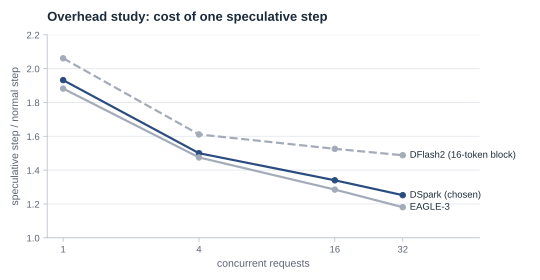
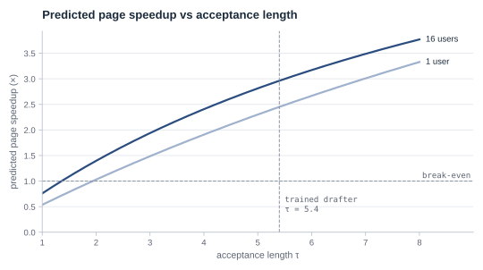
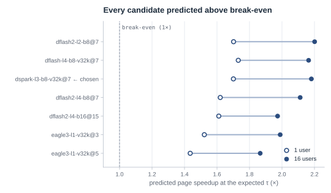
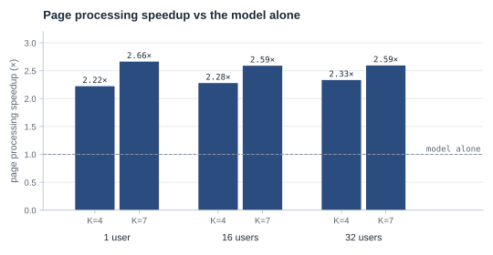
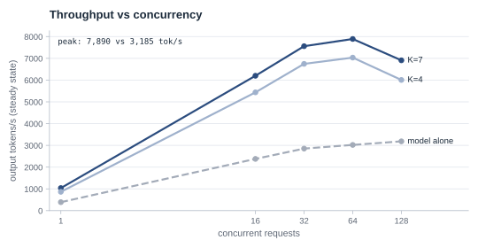
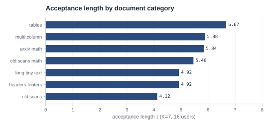
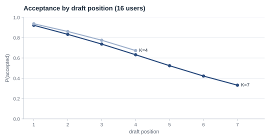

# 2.6× faster OCR with a trained speculative-decoding drafter

[](https://github.com/d-nyamkhuu/lightonocr-speculative-decoding/actions/workflows/checks.yml)


[](https://huggingface.co/nyamkhuu/LightOnOCR-2-1B-DSpark)

An end-to-end inference-optimization project for
[LightOnOCR-2-1B](https://huggingface.co/lightonai/LightOnOCR-2-1B), a 1B-parameter
vision-language model that turns document images into Markdown. The project first measures
whether speculative decoding can pay off on such a small, already-fast model by finding its
break-even point, then builds the training data, trains a DSpark drafter and evaluates it on
held-out benchmark pages. The trained drafter is
[published on Hugging Face](https://huggingface.co/nyamkhuu/LightOnOCR-2-1B-DSpark).


**Contents**

- [Results at a glance](#results-at-a-glance) · [Why it matters](#why-it-matters)
- [How speculative decoding works](#how-speculative-decoding-works)
- [Data](#data): [evaluation pages](#evaluation-pages-olmocr-bench),
  [training pages](#training-pages-olmocr-mix-1025)
- [Approach](#approach-measure-first-then-train):
  [1. overhead study](#1-overhead-study-is-a-drafter-worth-training),
  [2. training](#2-training-the-drafter), [3. evaluation](#3-evaluation)
- [Results in detail](#results-in-detail): [page processing time](#page-processing-time),
  [throughput](#throughput), [where the drafter does best](#where-the-drafter-does-best)
- [Reproduce it](#reproduce-it): [charts and reports](#charts-and-reports),
  [GPU setup](#gpu-setup), [how a GPU step runs](#how-a-gpu-step-runs),
  steps [1](#step-1-overhead-study), [2](#step-2-training-data), [3](#step-3-training),
  [4](#step-4-evaluation)
- [Limitations](#limitations) · [License](#license)

## Results at a glance

| | Model alone | With the trained drafter (K=7) |
|---|---|---|
| **Page processing time** (1 / 16 / 32 concurrent users) | 1× | **2.66× / 2.59× / 2.59× faster** |
| **Peak throughput** on one GPU | 3,185 tokens/s | **7,890 tokens/s (2.5×)** |
| **Tokens accepted per model step** (τ) | 1 | **5.4–5.6** |
| **Extra weights to deploy** | – | [245 MB](https://huggingface.co/nyamkhuu/LightOnOCR-2-1B-DSpark), loaded by stock vLLM |

All numbers come from 300 held-out [olmOCR-bench](https://huggingface.co/datasets/allenai/olmOCR-bench)
pages across 7 document categories, served by vLLM v0.33.0 on one NVIDIA RTX PRO 6000.

**Try it:** the drafter is one flag on a standard vLLM server (tested with vLLM v0.33.0).

```bash
vllm serve lightonai/LightOnOCR-2-1B \
  --limit-mm-per-prompt '{"image": 1}' \
  --mm-processor-cache-gb 0 --no-enable-prefix-caching \
  --speculative-config '{"model": "nyamkhuu/LightOnOCR-2-1B-DSpark",
                         "num_speculative_tokens": 7}'
```

## Why it matters

- A page comes back 2.6× sooner for a single user, with the same model, prompt and client.
- At peak, one GPU produces 2.5× as many tokens, so a batch OCR job needs about 60% less GPU time.
- Deploying it means passing a 245 MB checkpoint to vLLM's `--speculative-config`.
- On a model this small, the drafter's own cost could have cancelled the gain. That cost was
  measured, and the break-even point found, before any training data was generated.

## How speculative decoding works

A language model writes text one token at a time, and every token takes a full pass through the
model. On a GPU, most of that pass is spent reading the model's weights from memory, not doing
arithmetic. So checking 8 tokens in one pass takes about as long as producing 1.

Speculative decoding puts that spare capacity to use. A small, fast **drafter** guesses the next
few tokens, and the **target** model checks all the guesses in one pass. Every guess that matches
what the target would have written is kept. At the first wrong guess, the target's own token is
used instead and the remaining guesses are thrown away.


Here one speculative step costs about twice a normal one. The target is a small 1B model, so a
normal step is already very short (about 2 ms), and running the drafter and checking its guesses
adds about as much again; with a larger target, the drafter's share would be much smaller. Each
speculative step still commits about 5.5 tokens instead of 1:


<details>
<summary><b>Terms used below</b> (τ, K, TTFT, TPOT, page processing time, break-even τ)</summary>

| Term | Meaning |
|---|---|
| **τ (tau)** | Mean acceptance length: tokens committed per target step. 1 without speculation, at most K + 1. |
| **K** | Tokens the drafter proposes per step. DSpark's 8-token block allows up to 7. |
| **TTFT** | Time to first token; for OCR it includes encoding the image, which speculation cannot shorten. |
| **TPOT** | Time per output token after the first; speculation shrinks this. |
| **Page processing time** | TTFT + tokens × TPOT: the time from sending a page to receiving its full transcription. |
| **Break-even τ** | The τ below which speculation makes pages slower. |
| **Users, concurrent requests** | How many requests the server handles at once; "16 users" means 16 requests in flight. |

</details>

### The model and the drafter

LightOnOCR-2-1B pairs a Pixtral **vision encoder** (about 2,400 image tokens per page) with a
28-layer **Qwen3 decoder** that writes the transcription. **DSpark** guesses a block of 8 tokens in
a single pass by reading the target's hidden states from three layers; a Markov head lets each
guess depend on the earlier ones in the block, and a confidence head scores each guess.


## Data

Both datasets come from Ai2's [olmOCR](https://github.com/allenai/olmocr) project, are published
under the ODC-BY license, and are pinned to a fixed revision in `configs/run.json`. Only their PDF
pages are used.

| | Evaluation | Training |
|---|---|---|
| **Dataset** | [olmOCR-bench](https://huggingface.co/datasets/allenai/olmOCR-bench) | [olmOCR-mix-1025](https://huggingface.co/datasets/allenai/olmOCR-mix-1025) |
| **What it is** | 1,403 PDFs for benchmarking OCR systems, in 7 categories | about 270,000 single-page PDFs from four sources |
| **Used here** | 300 pages, sampled evenly across the categories | 20,500 pages from the train split |
| **Text used** | none: only speed and τ are measured | the target model's own transcriptions |

Every page is rendered to PNG at 1,540 px on its longest side, as the LightOnOCR model card
recommends, and sent as the only content of the prompt.

### Evaluation pages: olmOCR-bench

The benchmark pairs each PDF with unit tests for the transcription (text present, reading order,
table cells, math). Those tests are not run here, because the evaluation measures how fast the
model transcribes, not what it writes. The first page of each sampled PDF is used.

The sample is drawn with a fixed seed, taking one page from each category in turn: 44 pages per
category, except old scans with math, which has only 36 PDFs and contributes all of them. The
overhead study's 100 pages are the first 100 of the same sample, 14 or 15 per category.

| Category | Content | PDFs in benchmark | Pages used |
|---|---|---|---|
| arXiv math | arXiv papers dense with equations | 522 | 44 |
| Headers and footers | documents whose running headers, footers and page numbers should be left out | 266 | 44 |
| Long tiny text | pages of very small print, from the Internet Archive | 62 | 44 |
| Multi-column | multi-column layouts, where reading order matters | 231 | 44 |
| Old scans | historical scans from the Library of Congress | 98 | 44 |
| Old scans with math | scanned pages with math, from the Internet Archive | 36 | 36 |
| Tables | pages built around tables | 188 | 44 |
| **Total** | | **1,403** | **300** |

### Training pages: olmOCR-mix-1025

The mix ships its pages as single-page PDFs in tarballs of about 1 GB, with GPT-4.1 transcriptions
alongside. Those transcriptions are not used: the drafter has to predict what LightOnOCR writes,
so the target model transcribes every page itself.

Pages come from the first few train-split tarballs of each subset, shuffled with a fixed seed and
capped at a quota per subset. Books and archival pages make up 39% of the training pages, against
14% of the mix:

| Subset | Content | Train pages in mix | Tarballs read | Pages used |
|---|---|---|---|---|
| `00_documents` | mixed documents from various sources | 231,668 | 3 | 12,500 |
| `01_books` | book pages | 16,575 | 1 | 3,000 |
| `02_loc_transcripts` | Library of Congress documents | 9,891 | 2 | 2,500 |
| `03_national_archives` | U.S. National Archives documents | 9,828 | 4 | 2,500 |
| **Total** | | **267,962** | **10** | **20,500** |

- **No overlap with the evaluation.** Any training PDF byte-identical to a benchmark PDF is
  dropped; none were found.
- **Clean targets.** Of the 20,500 answers, 4.3% hit the 4,096-token limit, mostly in repetition
  loops, and were dropped, leaving 19,610 conversations.
- **Validation split.** The pipeline holds out 2.5% of source documents, so pages of one document
  never sit on both sides.

## Approach: measure first, then train

### 1. Overhead study: is a drafter worth training?

The target is small and fast, so a drafter's own cost is a large fraction of each step. To measure
that cost without training anything, the target was served with **randomly initialised** drafters.
Random weights accept almost nothing (τ ≈ 1), so each one's time per token is the pure cost of a
speculative step. Combined with the model-alone baseline, that predicts page speedup at any τ.



A speculative step costs 1.9–2.1× a normal one for a single request and 1.2–1.5× at 32 concurrent
requests, where the GPU is busier anyway. So the break-even τ for the chosen drafter is 1.93 for one
user and 1.34 at 16 users. Decoding is 97% of page processing time (median page: 972 output tokens),
so a drafter can affect almost the whole request.



**The decision.** Published results for these drafter types report a mean τ of about 3.5 for
block drafters (DFlash, DSpark) and 3.0 for EAGLE-3, far above the break-even τ. At those values
every candidate was predicted to make pages 1.4–1.7× faster for one user and 1.9–2.2× at 16 users,
while training-free n-gram lookup measured only 0.83× (slower) for one user and 1.09× at 16. So a
drafter was worth training.

**Why DSpark.** The 3-layer DSpark is expected to accept more tokens per step than EAGLE-3 (τ 3.5
against 3.0) at a similar step cost, so it is predicted to be faster: 1.70× against at most 1.52×
for one user, and 2.18× against at most 1.99× at 16 users. It also costs less per step than the
4-layer DFlash2, most of all with its 16-token block (the dashed line in the step-cost chart): a
break-even τ of 1.93 against 2.06 for one user and 1.34 against 1.53 at 16 users. Among the
candidates within 5% of the best prediction, DSpark was also the cheapest to train.



*Candidate names read `architecture-layers-block-vocabulary@K`: `dspark-l3-b8-v32k@7` is a
3-layer DSpark with 8-token blocks, a 32k-token vocabulary and 7 draft tokens per step.*

One deliberate deviation: the drafter was trained with the full 151,936-token vocabulary instead of
the 32k pruned one, because pruning saved only about 7% of step time and a pruned vocabulary can
never propose the tokens it drops.

**Prediction vs measured.** After training, the measured τ was plugged back into the overhead
study's formula, with the 32k-vocabulary drafter's step cost standing in for the trained one:

| Users | Measured τ | Predicted page speedup | Measured |
|---|---|---|---|
| 1 | 5.59 | 2.52× | 2.66× |
| 16 | 5.40 | 2.96× | 2.59× |
| 32 | 5.46 | 3.05× | 2.59× |

Close for one user; 14–18% optimistic under load. Part of the gap is the proxy (the full-vocabulary
drafter costs ~7% more per step). The rest is likely per-step work that grows with accepted tokens,
which a random drafter (τ ≈ 1) never exercises. The decision to train held with a wide margin, but
random-drafter timing is best treated as a screen rather than a precise forecast under load.

### 2. Training the drafter


- **Training pages.** 20,500 pages from olmOCR-mix-1025 (see [Data](#training-pages-olmocr-mix-1025)).
- **On-policy targets.** The target transcribed every page itself (14.1M tokens), so the drafter
  learns what this model writes. After dropping truncated answers, 19,610 conversations remained.
- **Hidden states.** `speculators` re-ran every conversation through a vLLM server that saves the
  activations of the three layers DSpark reads (2, 14 and 25) plus the final layer (28), which
  `speculators` saves by default: about 24 MB per page, 463 GB in total. Training then reads these
  from disk instead of running the target.
- **Training.** 3 layers, 8-token blocks, 4 epochs, 32,768 tokens per step, loss 90% total-variation
  distance to the target's full distribution plus 10% cross-entropy. Training was limited by disk,
  not GPU: the network disk delivered 0.43 GB/s against the 2.1 GB/s the GPU could consume.

### 3. Evaluation

The model alone and the drafter (K=4 and K=7) served the same 300 held-out olmOCR-bench pages with
the same engine settings, so the drafter is the only difference. Page processing time was measured
at 1, 16 and 32 concurrent users and throughput up to 128. The benchmark client streams each
response and times tokens, not chunks, so a burst of several speculative tokens in one chunk is not
miscounted; τ comes from vLLM's Prometheus counters, diffed around each measurement.

**Greedy and sampled decoding.** Every number in this README uses greedy decoding: at each step
the model writes its single most likely token, so a page always gets the same transcription. The
evaluation also ran with sampled decoding, the model card's recommended setting (temperature 0.2,
top-p 0.9), where each token is drawn at random from the model's most likely candidates. Its
results are kept in `results/dspark/summary.json`.

**Why two draft lengths.** DSpark's 8-token block allows up to K=7 draft tokens, but the best K is
not known in advance. A longer draft can commit more per step (τ is at most K + 1, so K=4 caps it
at 5), but each extra guess is less likely to be accepted, since it needs every earlier guess to be
right, and the target still has to verify it. That verification costs more when many requests share
the GPU, so a shorter draft could win under load. K=4 tests that case.

## Results in detail

### Page processing time



| Users | τ, K=4 | τ, K=7 | Time per token: model alone | K=4 | K=7 |
|---|---|---|---|---|---|
| 1 | 4.35 | 5.59 | 2.37 ms | 0.95 ms | **0.75 ms** |
| 16 | 4.25 | 5.40 | 6.58 ms | 2.61 ms | **2.17 ms** |
| 32 | 4.27 | 5.46 | 11.15 ms | 4.40 ms | **3.75 ms** |

τ ≈ 5.5 is far above the break-even of about 1.9, and above the 3.5 that published results led the
decision to expect. K=7 beats K=4 everywhere, even at 32 users: the extra guesses cost a little per
step but are accepted often enough to pay for themselves. K=4's τ of about 4.3 is already close to
its ceiling of 5, while K=7 reaches 5.4–5.6.

### Throughput



The model alone levels off at about 3,000–3,200 tokens/s, because each page's ~2,400 image tokens
already fill the GPU. With the drafter, peak throughput is **2.5× higher**, best at around 64
concurrent requests; at 128 it is still 2.2× the model alone.

<details>
<summary>Throughput table (steady-state output tokens/s)</summary>

| Concurrent requests | Model alone | K=4 | K=7 |
|---|---|---|---|
| 16 | 2,378 | 5,436 | 6,199 |
| 32 | 2,852 | 6,746 | 7,558 |
| 64 | 3,021 | 7,034 | **7,890** |
| 128 | **3,185** | 6,006 | 6,908 |

Steady state is the window in which every request slot was busy, rebuilt from per-request timings
so the tail of the run (a few long pages finishing) does not dilute it.

</details>

### Where the drafter does best



Tables, full of repeated structure (`<td>`, `|`), are the easiest to predict; noisy old scans are the
hardest but still reach τ 4.1.



The first guess is accepted 92% of the time and the seventh 33%, since it needs every earlier guess
to be right too. Positions 5–7 still add about 1.3 tokens per step, which is why K=7 wins.

## Reproduce it

Every command runs from the root of this repository. The charts and reports need only
Python; rerunning the experiments needs a GPU machine and four steps.

### Charts and reports

These need Python 3.12+ and [uv](https://docs.astral.sh/uv/):

```bash
uv sync
# redraw the README charts from the committed summaries
uv run ocrdraft report
```

### GPU setup

The GPU steps run inside the vLLM v0.33.0 container, which provides vLLM, PyTorch and CUDA. The
GPU machine needs:

- **Docker** with the NVIDIA Container Toolkit.
- **One GPU with about 96 GB of memory**, like the RTX PRO 6000 used here. On a smaller GPU, lower
  `--max-num-seqs` and `--gpu-memory-utilization` on the servers, and `--total-seq-len` in training.
- **About 1 TB of free disk** in the repository's `data/` folder, which holds every work file
  (model, pages, hidden states, checkpoints). It can be a symbolic link to a larger disk.

> [!TIP]
> To check the results without training, do the setup below, then skip to
> [step 4](#step-4-evaluation) and serve the published drafter instead of your own.

Start the container from the repository root. It mounts the repository at `/work`, so `data/` is
`/work/data` inside it:

```bash
docker run --gpus all --ipc=host -it --name ocrdraft --entrypoint bash \
  -v "$PWD":/work -w /work -e HF_HOME=/work/data/cache/huggingface \
  vllm/vllm-openai@sha256:d825baf9ce4b1b6bfc5ecc7b79880c7e6748c65a72d697ce3d47607aafa84c6e
```

Inside it, install the repository and `speculators`, and download the model at the pinned
revision:

```bash
pip install -e . speculators==0.9.0
hf download lightonai/LightOnOCR-2-1B --local-dir data/model \
  --revision be7c41313c30e940fe5571de59e5fabc779e00c8
```

### How a GPU step runs

Most steps pair a vLLM server with a client, each in its own terminal:

1. **Terminal 1** runs `vllm serve` with that step's flags. It is ready once it logs
   `Application startup complete.`
2. **Terminal 2** runs the client. `ocrdraft` clients wait for the server on their own;
   `speculators` commands must start only once it is ready.
3. **When the client finishes,** stop the server with Ctrl+C. Only one server fits on the GPU.

Open terminal 2 in the same container with `docker exec -it ocrdraft bash`.

Every server reads its shared settings from [`configs/vllm.yaml`](configs/vllm.yaml): served
model name, 8,192-token context, one image per prompt, no prefix caching. If an `ocrdraft` client
reports incomplete cells, running it again redoes only those.

| Step | Server in terminal 1 | Client in terminal 2 | Result |
|---|---|---|---|
| [1. Overhead study](#step-1-overhead-study) | model alone, n-gram, 7 random drafters | `ocrdraft overhead-bench` | `results/overhead/summary.json` |
| [2. Training data](#step-2-training-data) | bulk generation, then hidden-state saving | `ocrdraft generate`, `speculators` | hidden states in `data/hs` |
| [3. Training](#step-3-training) | none | `speculators.train` | `data/ckpt/checkpoint_best` |
| [4. Evaluation](#step-4-evaluation) | model alone, drafter at K=7 and K=4 | `ocrdraft eval` | `results/dspark/summary.json` |

<details>
<summary>The <code>ocrdraft</code> commands</summary>

`ocrdraft` holds the project's Python steps; it never starts a server. Each command prints its
arguments with `ocrdraft <command> -h`; the table shows the main ones. Fixed choices (model and dataset revisions, drafter shapes,
benchmark cells, training-page subsets) live in [`configs/run.json`](configs/run.json).

| Command | What it does |
|---|---|
| `render-bench`<br>`--out --pages --seed` | Renders page 1 of olmOCR-bench PDFs to PNG, sampled evenly across the 7 document categories |
| `token-freq`<br>`--out` | Writes the token-frequency table `speculators` needs to build a pruned-vocabulary drafter |
| `drafter-args`<br>`NAME` | Prints the `speculators train` architecture flags of a drafter in `configs/run.json` |
| `overhead-bench`<br>`CONFIG --pages --out --server` | Times one overhead-study configuration against the running server |
| `render-train`<br>`--out --workers` | Downloads olmOCR-mix and renders the training pages, dropping any identical to a benchmark page |
| `generate`<br>`--pages --out --concurrency --server` | Has the running server transcribe every training page; these answers are what the drafter learns |
| `conversations`<br>`--answers --pages --out` | Turns complete answers into `speculators` conversations, split into train and val by source document |
| `merge-prepared`<br>`--parts --out` | Joins the prepared train and val data and writes the `--train-data-ratio` that separates them |
| `eval`<br>`CONFIG --pages --out --server` | Times one configuration on the held-out pages against the running server, in every mode |
| `report`<br>`--overhead-raw --drafter-raw` | Rebuilds the two `summary.json` files from raw results where they exist, then redraws the README charts |

</details>

### Step 1: Overhead study

**Prepare (no server).** Render 100 benchmark pages and build each candidate drafter with random
weights:

```bash
ocrdraft render-bench --out data/overhead_pages --pages 100
ocrdraft token-freq --out data/drafters/_data/token_freq.pt
for name in dflash2-l4-b8 dflash2-l2-b8 dflash2-l4-b16 \
            dflash-l4-b8-v32k dspark-l3-b8-v32k eagle3-l1-v32k; do
  python -m speculators.train --dry-run --verifier-name-or-path data/model \
    $(ocrdraft drafter-args $name) \
    --data-path data/drafters/_data --save-path data/drafters/$name
done
```

**Time each configuration.** Serve it with `--max-num-seqs` and `--speculative-config` from
this table, then run `ocrdraft overhead-bench <configuration>`. Configurations with
speculation also need `--per-request-spec-decode-metrics summary`.

| Configuration | Max seqs | Speculative config |
|---|---|---|
| `baseline` | 128 | none |
| `ngram` | 32 | `{"method": "ngram", "prompt_lookup_min": 2, "prompt_lookup_max": 5, "num_speculative_tokens": 5}` |
| `<drafter>@<K>` | 32 | `{"model": "data/drafters/<drafter>", "num_speculative_tokens": <K>}` |

The seven drafter configurations are `dflash2-l4-b8@7`, `dflash2-l2-b8@7`, `dflash2-l4-b16@15`,
`dflash-l4-b8-v32k@7`, `dspark-l3-b8-v32k@7`, `eagle3-l1-v32k@3` and `eagle3-l1-v32k@5`.

For example, `dflash2-l4-b8@7`:

```bash
# terminal 1
vllm serve data/model --config configs/vllm.yaml --max-num-seqs 32 \
  --speculative-config '{"model": "data/drafters/dflash2-l4-b8", "num_speculative_tokens": 7}' \
  --per-request-spec-decode-metrics summary
```

```bash
# terminal 2
ocrdraft overhead-bench dflash2-l4-b8@7 --pages data/overhead_pages --out results/overhead/raw
```

**Summarise (no server).** Once every configuration is timed, write
`results/overhead/summary.json` and redraw the charts:

```bash
ocrdraft report
```

<details>
<summary>What step 1 does</summary>

- `speculators train --dry-run` builds a drafter and saves it without training. Random weights
  are enough here, because the study measures only what a speculative step costs.
  `ocrdraft drafter-args` supplies each drafter's architecture from `configs/run.json`, and
  `ocrdraft token-freq` writes the token table that the 32k-vocabulary drafters need. Run it
  first: without the table, `speculators` only logs a warning and builds those drafters with the
  full 151,936-token vocabulary, which changes the step cost being measured.
- `overhead-bench baseline` times requests that decode exactly 1,024 tokens at 1 to 128 concurrent
  users, then complete transcriptions at 1 and 16 users. The drafters are timed on the same
  1,024-token requests at 1, 4, 16 and 32 users, and n-gram on the complete transcriptions.
- N-gram lookup is speculation without a trained drafter: vLLM guesses the next tokens by finding
  the last few tokens earlier in the text.
- `--per-request-spec-decode-metrics summary` makes vLLM add each request's speculation counts to
  its response, which the client records with the timings.
- Each benchmark cell is saved as a JSON file in `results/overhead/raw/<configuration>/`.

</details>

### Step 2: Training data

**Render the training pages (no server).** This downloads 10 olmOCR-mix tarballs and renders the
20,500 pages described in [Data](#training-pages-olmocr-mix-1025):

```bash
ocrdraft render-train --out data/train_pages
```

**Collect the model's answers.** The server is tuned for bulk generation. `ocrdraft generate`
sends every page and saves the answers; `ocrdraft conversations` turns the complete ones into
`speculators` conversations, split into train and validation by source document.

```bash
# terminal 1
vllm serve data/model --config configs/vllm.yaml \
  --max-num-seqs 256 --max-num-batched-tokens 16384 --gpu-memory-utilization 0.92
```

```bash
# terminal 2
ocrdraft generate --pages data/train_pages --out data/answers.jsonl
ocrdraft conversations --answers data/answers.jsonl --pages data/train_pages \
  --out data/conversations
```

**Save the hidden states.** This server saves the layers DSpark reads for every request it
processes. In terminal 2, once it is ready, `speculators` tokenizes the conversations and sends
them through it, collecting about 463 GB of hidden states in `data/hs`.

```bash
# terminal 1
vllm serve data/model --config configs/vllm.yaml \
  --max-num-seqs 128 --gpu-memory-utilization 0.9 --enable-scale-out \
  --speculative-config '{"method": "extract_hidden_states", "num_speculative_tokens": 1,
    "draft_model_config": {"hf_config": {
      "eagle_aux_hidden_state_layer_ids": [2, 14, 25, 28]}}}' \
  --kv-transfer-config '{"kv_connector": "ExampleHiddenStatesConnector",
    "kv_role": "kv_producer",
    "kv_connector_extra_config": {"shared_storage_path": "/work/data/hs_tmp"}}'
```

```bash
# terminal 2, once the server is ready
for split in train val; do
  python -m speculators prepare-data --model data/model \
    --data data/conversations/$split.jsonl --output data/prep_parts/$split \
    --seq-length 8192 --render-endpoint http://127.0.0.1:8000 --no-skip-token-freq
done
ocrdraft merge-prepared --parts data/prep_parts --out data/prep
python -m speculators generate-offline-data --endpoint http://127.0.0.1:8000/v1 \
  --preprocessed-data data/prep --output data/hs --concurrency 128 --validate-outputs
```

<details>
<summary>What step 2 does</summary>

- `render-train` writes `data/train_pages/manifest.jsonl`, one line per page with its source
  document and train/validation split.
- The generation server allows 256 concurrent requests, processes up to 16,384 tokens per step and
  gives the KV cache more GPU memory. `generate` sends 512 pages at a time and appends answers to
  `data/answers.jsonl`; a rerun skips pages already answered.
- The hidden-state server saves layers 2, 14 and 25, which DSpark reads, plus the final layer, 28,
  into `data/hs_tmp`. `--enable-scale-out` adds the render endpoint that `prepare-data` uses to
  tokenize page images. The recorded run started this server through the `speculators` script
  `scripts/launch_vllm.py`, which builds the same command and also sets `--api-server-count` and
  `--renderer-num-workers` from the CPU count; those settings speed up `prepare-data` on machines
  with many CPUs but do not change the saved hidden states.
- `prepare-data` tokenizes each split on its own, so validation stays held out.
  `ocrdraft merge-prepared` joins them, train first, into `data/prep` and writes the
  `--train-data-ratio` that separates them again.
- `generate-offline-data` sends every prepared conversation through the server and collects its
  saved hidden states in `data/hs`.

</details>

### Step 3: Training

Stop the server: training reads the saved hidden states from disk.

```bash
python -m speculators.train --verifier-name-or-path data/model \
  --speculator-type dspark --num-layers 3 --block-size 8 --target-layer-ids 2 14 25 \
  --full-attention-indices 2 --markov-rank 256 \
  --enable-confidence-head --confidence-head-with-markov \
  --loss-fn '{"ce": 0.1, "tv": 0.9}' --total-seq-len 32768 --max-anchors 1024 \
  --epochs 4 --lr 6e-4 --scheduler-type cosine --scheduler-warmup-ratio 0.04 \
  --data-path data/prep --hidden-states-path data/hs --on-missing raise \
  --train-data-ratio "$(cat data/prep/train_data_ratio)" \
  --draft-attn-impl simple_flex_attention \
  --save-path data/ckpt --save-best --log-dir data/ckpt/logs
```

If training runs out of GPU memory, lower `--total-seq-len` to 16384 or 8192.

<details>
<summary>What the training flags mean</summary>

- Lines 2–4 set the DSpark architecture, the same flags as `ocrdraft drafter-args dspark`.
- Lines 5–6 are the recipe from [Training the drafter](#2-training-the-drafter): 90%
  total-variation and 10% cross-entropy loss, 32,768 tokens per step, 4 epochs, cosine schedule.
- `--train-data-ratio` reads the value `ocrdraft merge-prepared` wrote.
- Checkpoints go to `data/ckpt`; `--save-best` keeps the best one in `data/ckpt/checkpoint_best`.

</details>

### Step 4: Evaluation

**Render the evaluation pages (no server).** 300 olmOCR-bench pages, whose first 100 are the
overhead study's pages:

```bash
ocrdraft render-bench --out data/eval_pages --pages 300
```

**Time each configuration.** Serve it with `--max-num-seqs 128` and the speculative config in
this table, then run `ocrdraft eval <configuration>`. Configurations with a drafter also need
`--per-request-spec-decode-metrics summary`.

| Configuration | Speculative config |
|---|---|
| `baseline` | none |
| `dspark@7` | `{"model": "data/ckpt/checkpoint_best", "num_speculative_tokens": 7}` |
| `dspark@4` | `{"model": "data/ckpt/checkpoint_best", "num_speculative_tokens": 4}` |

To evaluate the published drafter instead, use `"model": "nyamkhuu/LightOnOCR-2-1B-DSpark"`.
For example, `dspark@7`:

```bash
# terminal 1
vllm serve data/model --config configs/vllm.yaml --max-num-seqs 128 \
  --speculative-config '{"model": "data/ckpt/checkpoint_best", "num_speculative_tokens": 7}' \
  --per-request-spec-decode-metrics summary
```

```bash
# terminal 2
ocrdraft eval dspark@7 --pages data/eval_pages --out results/dspark/raw
```

**Summarise (no server).** Write `results/dspark/summary.json` and redraw the charts:

```bash
ocrdraft report
```

<details>
<summary>What step 4 measures</summary>

`ocrdraft eval` measures each configuration in three modes:

- **greedy**: always the most likely token, at 1 user (56 pages, 8 per category) and at 16 and 32
  users (all 300 pages). Results go to `results/dspark/raw/eval/<configuration>/`.
- **sampled**: the same cells with the model card's sampling settings (temperature 0.2, top-p
  0.9), into `eval_sampled/<configuration>/`.
- **throughput**: 600 greedy requests at 64 and at 128 concurrent users, into
  `eval_throughput/<configuration>/`.

The recorded run served the greedy and sampled cells from a 32-slot server and the throughput
cells from a 128-slot one; a single 128-slot server per configuration covers all three modes.

</details>

<details>
<summary>Repository layout</summary>

| Path | Purpose |
|---|---|
| `configs/run.json` | pinned model and dataset revisions; drafter candidates; benchmark cells; candidate ranking |
| `configs/vllm.yaml` | `vllm serve` settings shared by every server |
| `src/ocrdraft/cli.py` | the `ocrdraft` command |
| `src/ocrdraft/overhead.py` | analytic cost model, speedup model, candidate ranking |
| `src/ocrdraft/overhead_study.py` | overhead-study plan and benchmark cells per drafter configuration |
| `src/ocrdraft/drafter_pipeline.py` | training answers, `speculators` input files, evaluation cells |
| `src/ocrdraft/bench.py` | streaming benchmark client: TTFT, TPOT, speculation counters |
| `src/ocrdraft/data.py`, `mix.py` | evaluation pages (olmOCR-bench) and training pages (olmOCR-mix) |
| `src/ocrdraft/drafters.py` | `speculators` flags for each drafter shape |
| `src/ocrdraft/report_overhead.py`, `report_drafter.py` | raw results → `summary.json` |
| `src/ocrdraft/figures.py` | `summary.json` → the charts in `docs/figures/` |
| `results/*/summary.json` | the committed results behind every number here |
| `docs/figures/` | the README's charts and diagrams |

</details>

## Limitations

- One GPU type (RTX PRO 6000) and one vLLM version (v0.33.0).
- Raw request logs are not published, so the reports can be regenerated only from your own runs;
  the charts regenerate from the committed summaries, and the trained drafter is on
  [Hugging Face](https://huggingface.co/nyamkhuu/LightOnOCR-2-1B-DSpark).

## License

MIT, see [LICENSE](LICENSE).
